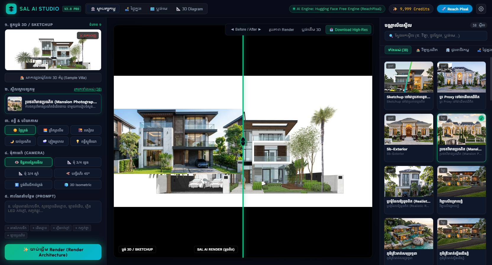

# 🏛️ SAL AI STUDIO - AI House Visualizer

**AI House Visualizer (SAL AI STUDIO V2)** is a professional, high-performance architectural visualization studio designed for Cambodian architects and designers. Transform 3D SketchUp models, architectural wireframes, and concept sketches into photorealistic 8K renders with interactive Before/After comparison.



---

## ✨ Features

- **Massive Central Viewport with Before/After Slider:** Compare your raw 3D model vs photorealistic AI render in real time.
- **38 Photorealistic Architectural Presets:**
  - 🏡 Luxury Modern Villas (វីឡាប្រណិតលើភ្នំ, មាត់បឹង, កោះរ៉ុង)
  - 🏢 Contemporary Shophouses & Townhouses (ផ្ទះអាជីវកម្ម & ផ្ទះល្វែង)
  - 🛋️ High-End Interiors (បន្ទប់ទទួលភ្ញៀវ, Penthouse)
  - 🗺️ 3D Master Plans & Urban Design (ប្លង់មេ 3D Top View)
  - 📐 3D Cutaway Diagrams & Isometrics (ប្លង់កាត់ 3D)
  - ⛅ Atmospheric Weather & Day/Night Lighting cycles
- **Multi-AI Engine Compatibility:**
  - **Google Gemini & Imagen 3** (Free tier via Google AI Studio)
  - **FAL.AI Engine** (FLUX.1 Dev image-to-image)
  - **Local Architectural Smart Engine** (Instant offline alignment)
- **100% Bilingual Interface:** Full support for Khmer (ភាសាខ្មែរ) and English.
- **Lightning Fast:** Zero bloat, loads in < 0.2s.

---

## 🚀 Quick Start (Local)

1. **Clone the repository:**
   ```bash
   git clone https://github.com/pisalreach1-glitch/ai-house-visualizer.git
   cd ai-house-visualizer
   ```

2. **Run the local server:**
   ```bash
   python server.py
   ```

3. **Open in your browser:**
   ```
   http://localhost:8080/
   ```

---

## ☁️ Deploying to Google AI Studio Apps & Google Cloud

1. **Google AI Studio App Integration:**
   - Go to [Google AI Studio Apps](https://aistudio.google.com/apps).
   - Connect your GitHub repository `pisalreach1-glitch/ai-house-visualizer`.
   - Use your free Google AI Studio API key (`AIzaSy...`) for instant free Gemini 2.0 Flash / Imagen 3 rendering.

2. **Deploy to GitHub Pages / Vercel / Cloud Run:**
   - **GitHub Pages:** Settings > Pages > Select `main` branch to host as a public web app.
   - **Cloud Run:** 1-click deploy directly from Google AI Studio.

---

## 👨‍💻 Creator & Support

- **Lead Architect & Visualizer:** Reach Pisal
- **Telegram:** [@Reachpisal](https://t.me/Reachpisal)
- **Studio:** SAL AI STUDIO V2.0 PRO
